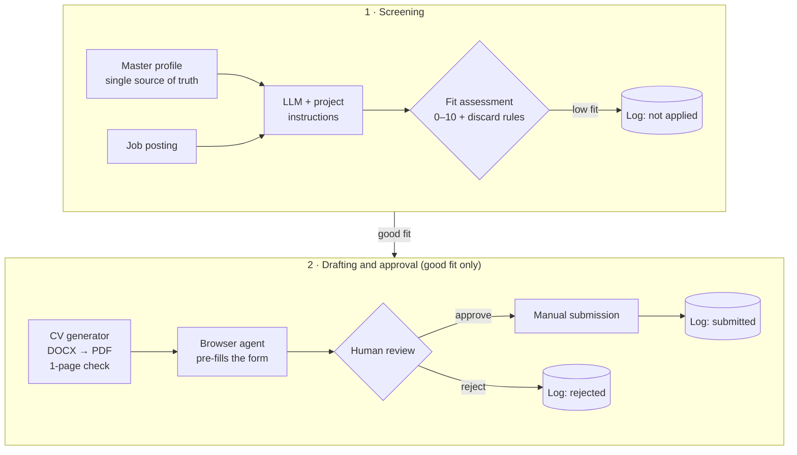
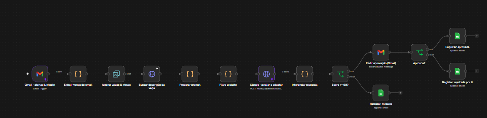
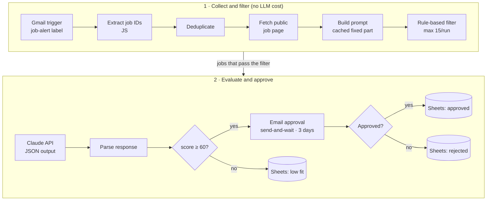

# LLM Job Application Assistant

A personal, human-in-the-loop system I built to support my own job search for data roles.
It uses an LLM (Claude) to screen job postings against a **verified profile**, draft tailored
one-page CVs and recruiter messages, and pre-fill application forms. A human (me) reviews
every output, and **every application is submitted manually**.

> The example profile and sample files use a fictional person ("Jane Doe"). The prompts,
> workflow and measurements come from my own use, with personal data removed; my name appears
> only as author. No recruiter names or companies are published. The only results reported are the ones in
> [What has been measured](#what-has-been-measured).

## The problem

Applying for many roles means rereading postings, judging fit and rewriting the CV every time.
An LLM makes this faster, but it brings a specific risk. Models invent experience, round numbers
up and misread profiles, and they do it confidently. I wanted the speed without the fabrication.

## Architecture



| Component | What it does | Where |
|---|---|---|
| Master profile | One Markdown file with every verified fact about my background and its source. It also has a list of **forbidden facts** (unproven numbers and claims) and **[TO CONFIRM]** facts that cannot be used yet. | [`knowledge-base/`](knowledge-base/) (example) |
| Project instructions | A fixed flow: read the posting → score fit (0–10 in the Claude project, 0–100 in the n8n workflow) with hard discard rules (years of experience, required stack, language, location) → ATS-friendly 1-page CV → recruiter message → likely interview questions. | [`prompts/`](prompts/) |
| Rules to limit invented facts | Only master-profile facts. Pre-validated sentences per project. Automatic 1-page check. File metadata. | [`prompts/`](prompts/), [`src/`](src/) |
| CV generator | Builds the CV from 3 base variants (Data Engineer / Analyst / Scientist) with `python-docx`, converts it to PDF with LibreOffice and checks the page count with `pypdf`. Rejects any fact not marked as verified in the master profile (CV generator only; drafts from the Claude project are not checked in code). | [`src/`](src/) |
| Screening agent | Claude in Chrome goes through a LinkedIn results page **read-only** and returns a ranked shortlist. | [`prompts/job-screening-prompt.md`](prompts/job-screening-prompt.md) |
| Form-filling agent | Claude in Chrome fills application forms, but **stops** at login/password, at CV upload and before submit, then shows a summary for approval. | [`prompts/form-filling-agent-prompt.md`](prompts/form-filling-agent-prompt.md) |
| Tracking | One sheet per application plus an index, and a reusable answers sheet for common form questions. | [`tracking/`](tracking/) (templates) |
| n8n prototype | Automated screening of job-alert emails (see below). | [`n8n/`](n8n/) |

## Design decisions

- **Single source of truth.** The LLM may only use facts from the master profile. Unproven
  numbers are listed explicitly as forbidden, so the model is told what *not* to say as well
  as what to say.
- **Validation in code, not only in prompts.** In the CV generator, every fact has an ID and a
  status. A CV variant is just a list of IDs, and the script rejects anything forbidden,
  still to confirm, unsourced, or moved under the wrong entry (e.g. an academic project bullet
  listed under a job). It then scans the final text for forbidden patterns and fails if the
  PDF is longer than one page.
- **Human-in-the-loop by default.** The system drafts and pre-fills. By design, it stops before
  logging in, uploading or submitting. This is enforced by prompt instructions, not by code.
- **Explicit guardrails for agents.** The browser agents have hard stop points and a list of
  forbidden actions instead of "be careful" instructions.
- **Cheap before expensive** (n8n). Rule-based filtering runs before any LLM call.

## n8n prototype: automated job screening



*The item counts on the canvas (e.g. "6 items" after the Claude node) are from the first test
run, before the rule-based filter was added. That is why the filter's connections show no counts.*

**Status:** prototype. The screening part (rule-based filter and Claude evaluation) was tested
manually; the approval branch and the three Google Sheets logging nodes were not. **Not active in production** (n8n Cloud, trial
version). Details in [`n8n/README.md`](n8n/README.md).



Key choices: a free rule-based filter (seniority level, title, "3+ years") before the LLM;
prompt caching for the fixed part (profile + rules; the run 1 cost below was measured without caching, and its effect has not been measured separately); structured JSON output (score 0–100, met
requirements, gaps, CV, cover letter); and a human approval step on every candidate job.

### What has been measured

Two separate manual test runs:

| Run | What was tested | Result |
|---|---|---|
| 1 | Claude evaluation, **before** the rule-based filter existed | 6 jobs were sent to the LLM and all 6 were rejected, matching my own assessment. All six were poor fits, so this run does not show how it scores a good fit. Cost: US$0.254 in total, ≈ **US$0.042 per job evaluated by Claude**. |
| 2 | Rule-based filter, on its own (on the same six postings) | Discarded 5 of 6 jobs before any LLM call. |

These are small functional tests, not a benchmark. The full pipeline (filter + LLM + approval
+ logging) has not been tested end to end.

## Limitations

- **Small scale, personal use.** The n8n workflow is not in production and has only been tested
  on a handful of postings.
- **Data source.** It reads public LinkedIn job pages without the official API. This may
  conflict with LinkedIn's terms; I use it only for personal, low-volume testing, and a
  production version would need an official source.
- **Fragile node linking.** Nodes are matched by item index. A `jobId` key would be more robust.
- **Silent failures.** If the API call fails or returns malformed JSON, the job gets a score of
  0 and is logged as "low fit", so a technical error looks the same as a weak match.
- **Untested logging.** None of the three Google Sheets logging nodes (approved / rejected /
  low fit) has been tested; the approved and rejected nodes also have no sheet ID set.
- **The fit score is an LLM judgment**, not a calibrated metric.
- **Agent guardrails are prompt-based.** The browser agents' stop points can't be enforced in
  code, which is why a human approves every step and submits manually.
- **No automated evaluation suite** for output quality yet.

## What I learned

- Telling the model what it must *not* claim (forbidden facts) worked better than only giving it
  the true facts.
- Some rules belong in code, not prompts: page count and fact whitelisting are checked
  deterministically.
- A cheap deterministic filter in front of an LLM cuts both cost and noise.
- Designing an agent's stop points up front is easier than trying to make it "careful" in general.
- Many real application forms break LLM-generated text (character limits, numeric-only fields,
  special characters), so outputs must be adapted to the target system, not just generated.

Real errors I ran into while using it, and the rule each one led to:
[`docs/lessons-learned.md`](docs/lessons-learned.md).

## Next steps (n8n)

- Test the three logging nodes and set the sheet ID in the approved/rejected ones
- Daily trigger
- Approval via Telegram
- Cheaper model for screening
- CV template in Google Docs
- End-to-end test
- Handle closed postings

## Running the CV generator

Requires Python 3.10+ and LibreOffice (`soffice` on the PATH).

```bash
pip install -r requirements.txt
python src/generate_cv.py \
  --profile knowledge-base/master-profile.example.md \
  --variant src/variants/data-analyst.json \
  --company ExampleCorp \
  --out output/
```

Expected output:

```text
Profile: 35 verified items, 8 forbidden, 3 to confirm
DOCX: output/CV_ExampleCorp_2026-11_data-analyst.docx
PDF:  output/CV_ExampleCorp_2026-11_data-analyst.pdf (1 page)

TO CONFIRM (not used):
  - C-01: Final grade of the postgraduate thesis: waiting for the official transcript.
  ...
```

If a variant uses a forbidden or unconfirmed fact, the script stops:

```text
Variant rejected:
  - X-01: FORBIDDEN fact ("Reduced quoting time by 30%" at Acme: ...)
  - C-02: still TO CONFIRM, cannot be used (...)
  - F-201: belongs to PRJ-01, not to EXP-01
```

Use `--no-pdf` to skip the conversion if LibreOffice isn't installed (the 1-page check is then
skipped too).

## Repository structure

```text
├── assets/                  n8n workflow screenshot
├── knowledge-base/          example master profile (fictional Jane Doe)
├── prompts/                 the real prompts, translated and anonymised
├── src/
│   ├── generate_cv.py       CV generator with fact validation and 1-page check
│   └── variants/            the 3 base CVs, as lists of fact IDs
├── tracking/                application log, application sheet and answers sheet templates
├── n8n/                     sanitised workflow JSON + status
└── docs/lessons-learned.md  real errors and the rules that prevent them
```

## License

[MIT](LICENSE)
