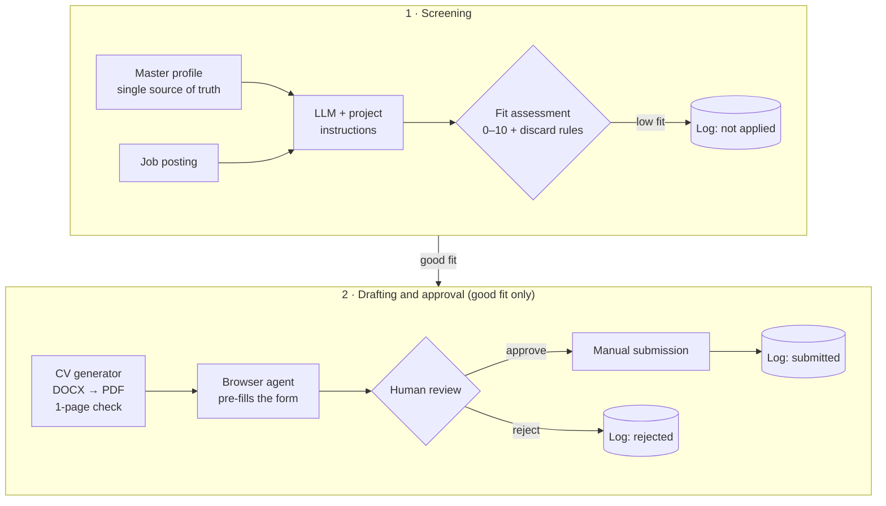
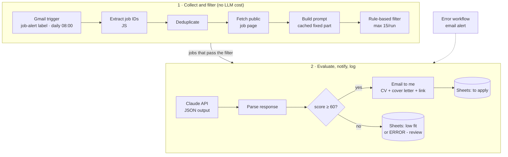

# LLM Job Application Assistant

**Author:** Andressa Avelar Belo · [LinkedIn](https://www.linkedin.com/in/andressaavelar) · [GitHub](https://github.com/aavelarbelo)

A personal, human-in-the-loop system I designed and built to support my own job search for data roles.
It uses an LLM (Claude) to screen job postings against a **verified profile**, draft tailored
one-page CVs and recruiter messages, and pre-fill application forms. A human (me) reviews
every output, and **every application is submitted manually**.

> Everything here comes from my own use. The profile in `knowledge-base/` is the public version
> of my real master profile; contact details, private notes and the companies I applied to are
> not published. The only results reported are the ones in
> [What has been measured](#what-has-been-measured).

## The problem

Applying for many roles means rereading postings, judging fit and rewriting the CV every time.
An LLM makes this faster, but it brings a specific risk. Models invent experience, round numbers
up and misread profiles, and they do it confidently. I wanted the speed without the fabrication.

## Architecture



| Component | What it does | Where |
|---|---|---|
| Master profile | One Markdown file with every verified fact about my background and its source. It also has a list of **forbidden facts** (unproven numbers and claims) and **[TO CONFIRM]** facts that cannot be used yet. | [`knowledge-base/`](knowledge-base/) (public version) |
| Project instructions | A fixed flow: read the posting → score fit (0–10 in the Claude project, 0–100 in the n8n workflow) with hard discard rules (years of experience, required stack, language, location) → ATS-friendly 1-page CV → recruiter message → likely interview questions. | [`prompts/`](prompts/) |
| Rules to limit invented facts | Only master-profile facts. Pre-validated sentences per project. Automatic 1-page check. File metadata. | [`prompts/`](prompts/), [`src/`](src/) |
| CV generator | Builds the CV from 3 base variants (Data Engineer / Analyst / Scientist) with `python-docx`, converts it to PDF with LibreOffice and checks the page count with `pypdf`. Rejects any fact not marked as verified in the master profile (CV generator only; drafts from the Claude project are not checked in code). | [`src/`](src/) |
| Screening agent | Claude in Chrome goes through a LinkedIn results page **read-only** and returns a ranked shortlist. | [`prompts/job-screening-prompt.md`](prompts/job-screening-prompt.md) |
| Form-filling agent | Claude in Chrome fills application forms, but **stops** at login/password, at CV upload and before submit, then shows a summary for approval. | [`prompts/form-filling-agent-prompt.md`](prompts/form-filling-agent-prompt.md) |
| Tracking | One sheet per application plus an index, and a reusable answers sheet for common form questions. | [`tracking/`](tracking/) (templates) |
| n8n workflow | Daily automated screening of job-alert emails, in production since 19 Nov 2026 (see below). | [`n8n/`](n8n/) |

## Design decisions

- **Single source of truth.** The LLM may only use facts from the master profile. Unproven
  numbers are listed explicitly as forbidden, so the model is told what *not* to say as well
  as what to say.
- **Validation in code, not only in prompts.** In the CV generator, every fact has an ID and a
  status. A CV variant is just a list of IDs, and the script rejects anything forbidden,
  still to confirm, unsourced, or moved under the wrong entry (e.g. an academic project bullet
  listed under a job). It then scans the final text for forbidden patterns and fails if the
  PDF is longer than one page.
- **Human-in-the-loop by default.** The system drafts and pre-fills. By design, it stops before
  logging in, uploading or submitting. This is enforced by prompt instructions, not by code.
- **Explicit guardrails for agents.** The browser agents have hard stop points and a list of
  forbidden actions instead of "be careful" instructions.
- **Cheap before expensive** (n8n). Rule-based filtering runs before any LLM call.

## n8n workflow: automated job screening


*Screenshot from an early test run (before the November changes); the current flow is in the
diagram below and in [`n8n/README.md`](n8n/README.md).*

**Status:** active since 19 Nov 2026 (n8n Cloud). It runs every day at 08:00. Postings that
score 60 or more arrive in my inbox with a tailored CV and cover letter; everything is logged
in Google Sheets. I review each one and submit applications myself.



Key choices: a free rule-based filter (seniority level, title, "3+ years") before the LLM;
prompt caching for the fixed part (profile + rules); structured JSON output (score 0–100, met
requirements, gaps, CV, cover letter); no waiting for approval inside the workflow, because I
decide and apply myself; and failures that are visible instead of silent.

### What has been measured

| Test | What was tested | Result |
|---|---|---|
| Run 1 (Nov) | Claude evaluation, before the rule-based filter existed | 6 postings, all rejected, matching my own assessment. Cost: 60,130 input + 13,438 output tokens = US$0.254, ≈ **US$0.042 per posting**. Output was 53% of the cost. |
| Run 2 (Nov) | Rule-based filter on the same six postings | Discarded 5 of 6 before any LLM call. |
| 19 Nov | Real postings, full pipeline (Gmail → Claude → Sheets) | AI & Data Engineer Trainee: 55 · Junior Data Engineer (Azure & Databricks): 58 · Data Engineer (1–4 years required): 38. All logged correctly as low fit; no CV generated for the 38. |
| 19 Nov | Notification email and inbox filter, with test data | Email arrives with score, gaps, link, CV and cover letter, and is filed in its own Gmail label. |

**Problems found in testing, and the fix for each**

- **Truncated responses.** Adaptive thinking used 5,764 of the 6,000 output tokens, so the JSON
  was cut off and a posting the model had scored 60 was logged as 0. Fix: thinking set to
  `between_tools`, `max_tokens` raised to 8,000; afterwards `stop_reason` was `end_turn`.
- **Silent failures.** An unreadable response used to look like a weak match. Now it is logged
  as "ERROR – review manually", and a separate error workflow emails me if the run fails.
- **Invented commitments.** A generated cover letter said I was ready to work on-site in
  another city, which is not in my profile. Fix: an explicit rule. In the next test, the
  location gap appeared in the summary for me to decide, not as a promise in the letter.
- **Noise at the source.** Before any LLM cost: LinkedIn job alerts reduced from 9 to 6, the
  "recommended jobs" feed turned off, and other LinkedIn emails moved out of the alert label.

These are small functional tests, not a benchmark. No posting has scored 60+ in production yet,
so the email with a real CV has only been tested with test data.

## Limitations

- **Small scale, personal use.** The n8n workflow went live on 19 Nov 2026 and has been tested
  on a handful of postings.
- **Data source.** It reads public LinkedIn job pages without the official API. This may
  conflict with LinkedIn's terms; I use it only for personal, low-volume testing, and a
  production version would need an official source.
- **Fragile node linking.** Nodes are matched by item index. A `jobId` key would be more robust.
- **Deduplication before evaluation.** A posting is marked as seen before Claude answers; if a
  run fails, that posting is not retried automatically (the error alert makes it visible).
- **Alerts arrive in batches.** LinkedIn sends several unrelated postings per email; the
  pre-filter and the 60-point threshold absorb the noise, but not all of it.
- **The fit score is an LLM judgment**, not a calibrated metric.
- **Agent guardrails are prompt-based.** The browser agents' stop points can't be enforced in
  code, which is why a human approves every step and submits manually.
- **No automated evaluation suite** for output quality yet.

## What I learned

- Telling the model what it must *not* claim (forbidden facts) worked better than only giving it
  the true facts.
- Some rules belong in code, not prompts: page count and fact whitelisting are checked
  deterministically.
- A cheap deterministic filter in front of an LLM cuts both cost and noise.
- Designing an agent's stop points up front is easier than trying to make it "careful" in general.
- Many real application forms break LLM-generated text (character limits, numeric-only fields,
  special characters), so outputs must be adapted to the target system, not just generated.

Real errors I ran into while using it, and the rule each one led to:
[`docs/lessons-learned.md`](docs/lessons-learned.md).

## Next steps (n8n)

- Collect 2–4 weeks of production data (postings processed, share above 60, monthly cost,
  applications sent) and report it here
- Cheaper model for the first screening, Sonnet only for CVs and letters
- Join nodes on `jobId` instead of item index
- Handle closed postings
- Move to self-hosted n8n (Docker) when the cloud trial ends

## Running the CV generator

Requires Python 3.10+ and LibreOffice (`soffice` on the PATH).

```bash
pip install -r requirements.txt
python src/generate_cv.py \
  --profile knowledge-base/master-profile.example.md \
  --variant src/variants/data-analyst.json \
  --company ExampleCorp \
  --out output/
```

Expected output:

```text
Profile: 35 verified items, 6 forbidden, 2 to confirm
DOCX: output/CV_ExampleCorp_2026-11_data-analyst.docx
PDF:  output/CV_ExampleCorp_2026-11_data-analyst.pdf (1 page)

TO CONFIRM (not used):
  - C-01: English level to declare: certificate planned for December 2026.
  ...
```

If a variant uses a forbidden or unconfirmed fact, the script stops:

```text
Variant rejected:
  - X-03: FORBIDDEN fact (Tableau: never used. ...)
  - C-02: still TO CONFIRM, cannot be used (...)
  - F-201: belongs to PRJ-01, not to EXP-01
```

Use `--no-pdf` to skip the conversion if LibreOffice isn't installed (the 1-page check is then
skipped too).

## Repository structure

```text
├── assets/                  n8n workflow screenshot
├── knowledge-base/          public version of my master profile
├── prompts/                 the real prompts, translated (contact details removed)
├── src/
│   ├── generate_cv.py       CV generator with fact validation and 1-page check
│   └── variants/            the 3 base CVs, as lists of fact IDs
├── tracking/                application log, application sheet and answers sheet templates
├── n8n/                     sanitised workflow JSON + status
└── docs/lessons-learned.md  real errors and the rules that prevent them
```

## License

[MIT](LICENSE)
