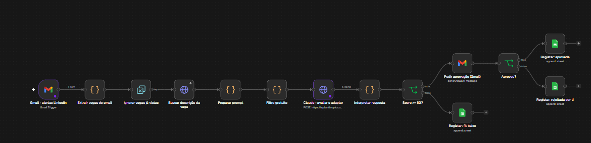
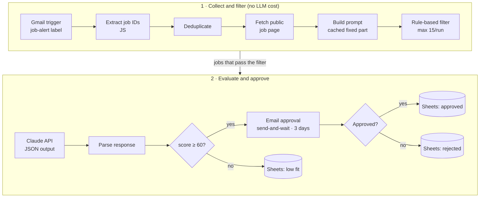

# n8n workflow: job-alert screening with Claude

**Status:** prototype. The screening part (rule-based filter and Claude evaluation) was tested
manually; the approval branch and the three Google Sheets logging nodes were not. **Not active in
production** (n8n Cloud, trial version). Applications are always submitted manually; the workflow only screens and drafts.

File: [`workflow_candidaturas_SANITIZADO.json`](workflow_candidaturas_SANITIZADO.json)
(sanitised: no credentials; the profile and rules inside the prompt were removed). Node names
and prompt text are in Portuguese, the language I built it in.

## Flow (14 nodes)

| # | Node (in the JSON) | What it does |
|---|---|---|
| 1 | `Gmail - alertas LinkedIn` | Polls hourly for unread emails with the job-alert label |
| 2 | `Extrair vagas do email` | JS: extracts job IDs from the alert email (one email lists several jobs) |
| 3 | `Ignorar vagas já vistas` | Drops job IDs seen in previous executions |
| 4 | `Buscar descrição da vaga` | Fetches the public job page (1 request every 3 s) |
| 5 | `Preparar prompt` | JS: keeps only the job description block and builds the API request. The fixed part (profile + rules) goes in `system` with `cache_control` |
| 6 | `Filtro gratuito` | JS, no API cost: drops senior/lead/manager titles and levels and "3+ years" requirements; max 15 jobs per run |
| 7 | `Claude - avaliar e adaptar` | Claude API call; asks for JSON only |
| 8 | `Interpretar resposta` | Parses the JSON (score 0–100, met requirements, gaps, CV, cover letter) |
| 9 | `Score >= 60?` | Threshold for human review |
| 10 | `Pedir aprovação (Gmail)` | Sends the CV and letter by email and waits up to 3 days for Approve / Reject |
| 11 | `Aprovou?` | Branches on the answer |
| 12–14 | `Registar: ...` | Appends a row to Google Sheets: approved / rejected / low fit |

## Design decisions

- **Cheap filter before the LLM.** Obvious mismatches (seniority, years required) are discarded
  with regular expressions, at no cost, before any API call.
- **Prompt caching** (added in v2 of the prompt node; the run 1 cost below was measured
  without caching, and the effect of caching has not been measured separately). The profile and
  rules are identical for every job, so they go in the cached `system` block; only the job
  description changes between calls.
- **Structured output.** The model must answer with a fixed JSON schema, so the next nodes can
  branch on `score` and fill the email and the sheet without parsing free text.
- **A human always approves.** A high score only triggers an approval email; the application
  itself is always submitted manually.

## What has been measured

Two separate manual test runs:

| Run | What was tested | Result |
|---|---|---|
| 1 | Claude evaluation, **before** the rule-based filter existed | 6 jobs were sent to the LLM and all 6 were rejected, matching my own assessment. All six were poor fits, so this run does not show how it scores a good fit. Cost: US$0.254 in total, ≈ **US$0.042 per job evaluated by Claude**. |
| 2 | Rule-based filter, on its own (on the same six postings) | Discarded 5 of 6 jobs before any LLM call. |

The screenshot is from run 1. The item counts on the canvas come from that run, which is why
the filter's connections (added afterwards) show no counts.

These are small functional tests, not a benchmark. The full pipeline has not been tested end
to end.

## Limitations

- **Data source:** it reads public LinkedIn job pages without the official API. This may
  conflict with LinkedIn's terms; I use it only for personal, low-volume testing, and a
  production version would need an official source.
- **Index-based linking:** several nodes match items by position (`vagas[i]`). If a node drops
  or reorders items, data can be matched to the wrong job. Improvement: join on `jobId`.
- **API failures can lose jobs:** a failed call or malformed JSON gives `score: 0`, which is
  logged as "low fit", so a technical error looks the same as a weak match. Because of the
  deduplication node, that job will not be retried.
- **Untested logging:** none of the three Google Sheets logging nodes (approved / rejected /
  low fit) has been tested; the approved and rejected nodes also have no sheet ID set.

## Next steps (not done yet)

- [ ] Test the three logging nodes and set the sheet ID in the approved/rejected ones
- [ ] Daily trigger
- [ ] Approval via Telegram
- [ ] Cheaper model for screening
- [ ] CV template in Google Docs
- [ ] End-to-end test
- [ ] Handle closed postings

## To import it

1. In n8n: *Workflows → Import from file*.
2. Create credentials: Gmail OAuth2, Google Sheets OAuth2, and a *Header Auth* credential for
   the Claude API (`x-api-key`), then select them in the nodes.
3. Replace the placeholders: `O_TEU_EMAIL` (approval email), `ID_DA_FOLHA_GOOGLE_SHEETS`, and
   `[REGRAS REMOVIDAS]` / `[PERFIL-MESTRE REMOVIDO]` in `Preparar prompt` (use a profile like
   [`../knowledge-base/master-profile.example.md`](../knowledge-base/master-profile.example.md)).
