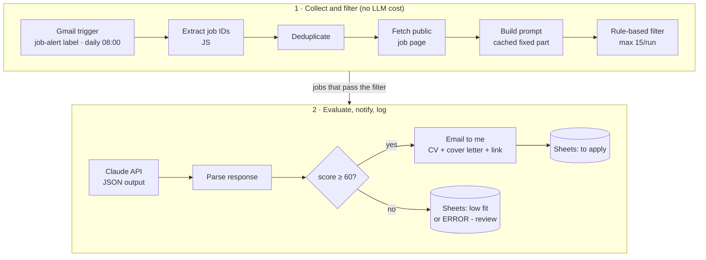

# n8n workflow: job-alert screening with Claude

**Status:** active since 19 Nov 2026 (n8n Cloud), running daily at 08:00 (Portugal time).
Applications are always submitted manually; the workflow screens, drafts, notifies and logs.

File: [`workflow_candidaturas_SANITIZADO.json`](workflow_candidaturas_SANITIZADO.json)
(sanitised: no credentials, no email address, no sheet ID; the profile and rules inside the
prompt are replaced by a note). Node names and prompt text are in Portuguese, the language I
built it in.

## Flow (12 nodes + a separate error workflow)

| # | Node (in the JSON) | What it does |
|---|---|---|
| 1 | `Gmail - alertas LinkedIn` | Polls once a day (08:00) for unread emails with the job-alert label |
| 2 | `Extrair vagas do email` | JS: extracts job IDs from the alert email (one email lists several jobs) |
| 3 | `Ignorar vagas já vistas` | Drops job IDs seen in previous executions |
| 4 | `Buscar descrição da vaga` | Fetches the public job page (1 request every 3 s) |
| 5 | `Preparar prompt` | JS: keeps only the job description block and builds the API request. The fixed part (profile + rules) goes in `system` with `cache_control`; `thinking: {"type": "between_tools"}`, `max_tokens: 8000` |
| 6 | `Filtro gratuito` | JS, no API cost: drops senior/lead/manager titles and levels and "3+ years" requirements; max 15 jobs per run |
| 7 | `Claude - avaliar e adaptar` | Claude API call (`claude-sonnet-5-5`); asks for JSON only |
| 8 | `Interpretar resposta` | Parses the JSON (score 0–100, met requirements, gaps, CV, cover letter) |
| 9 | `Score >= 60?` | Threshold for review |
| 10 | `Enviar vaga por email` | Sends me one email per posting: subject `[Vaga Claude] Role - Company (score/100)`; body with summary, gaps, link, CV and cover letter. A Gmail filter files it under its own label |
| 11 | `Registar: para candidatar` | Appends a row to Google Sheets with status "To apply" |
| 12 | `Registar: fit baixo` | Appends a row with status "Low fit", or "ERROR – review manually" if the response could not be read |

**Error workflow** (`Alerta de erro - Candidaturas`, not in the JSON): an Error Trigger plus a
Gmail node. If the main workflow fails, it emails me the failed node, the error message and a
link to the execution. It is set as the main workflow's *Error Workflow*.

## Design decisions

- **Cheap filter before the LLM.** Obvious mismatches (seniority, years required) are discarded
  with regular expressions, at no cost, before any API call.
- **Prompt caching.** The profile and rules are identical for every job, so they go in the
  cached `system` block; only the job description changes between calls. The effect of caching
  has not been measured separately.
- **Structured output.** The model must answer with a fixed JSON schema, so the next nodes can
  branch on `score` and fill the email and the sheet without parsing free text.
- **No approval step inside the workflow.** An earlier version waited for an approve/reject
  click for every posting (first by email, then by Telegram buttons). It made the workflow
  depend on me answering each time. Now it only notifies; I review and apply when I choose.
- **Failures must be visible.** Unreadable responses are logged as errors, not as low fit, and
  a failed run sends an email alert.

## What has been measured

| Test | What was tested | Result |
|---|---|---|
| Run 1 | Claude evaluation, before the rule-based filter existed | 6 postings, all rejected, matching my own assessment. Cost: US$0.254 in total, ≈ **US$0.042 per posting** (60,130 input + 13,438 output tokens). |
| Run 2 | Rule-based filter on the same six postings | Discarded 5 of 6 before any LLM call. |
| 19 Nov | Real postings, Gmail → Claude → Sheets | Scores 55, 58 and 38; all logged as low fit; no CV generated below 60 for the 38. |
| 19 Nov | Notification email and Gmail filter, with test data | Email arrives complete and is filed in its own label. |
| 19 Nov | Truncation fix | Before: `stop_reason: max_tokens`, 5,764 of 6,000 output tokens used by thinking. After: `stop_reason: end_turn`. |

These are small functional tests, not a benchmark. Not yet observed: a real posting scoring
60+ (the notification email has only been tested with test data), and the scheduled 08:00 run.

## Limitations

- **Data source:** it reads public LinkedIn job pages without the official API. This may
  conflict with LinkedIn's terms; I use it only for personal, low-volume use, and a larger
  version would need an official source.
- **Index-based linking:** several nodes match items by position (`vagas[i]`). If a node drops
  or reorders items, data can be matched to the wrong job. Improvement: join on `jobId`.
- **Deduplication before evaluation:** a posting is marked as seen before Claude answers. If a
  run fails, that posting is not retried automatically; the error email makes it visible.
- **Batch alerts:** LinkedIn groups unrelated postings in one email; the filter and threshold
  absorb part of the noise.

## Next steps

- [ ] 2–4 weeks of production data: postings processed, share above 60, monthly cost
- [ ] Cheaper model for the first screening, Sonnet only for CVs and letters
- [ ] Join on `jobId`
- [ ] Handle closed postings
- [ ] Self-hosted n8n (Docker) when the cloud trial ends

## To import it

1. In n8n: *Workflows → Import from file*.
2. Create credentials: Gmail OAuth2, Google Sheets OAuth2, and a *Header Auth* credential for
   the Claude API (`x-api-key`), then select them in the nodes.
3. Replace the placeholders: `YOUR_EMAIL@example.com` (notification email),
   `YOUR_GOOGLE_SHEET_ID`, and the `[REMOVED: ...]` blocks in `Preparar prompt` (use a profile
   like [`../knowledge-base/master-profile.example.md`](../knowledge-base/master-profile.example.md)).
4. Optional: create a Gmail filter on the subject `[Vaga Claude]` to file the emails under
   their own label, and an error workflow (Error Trigger → Gmail) set as *Error Workflow*.
